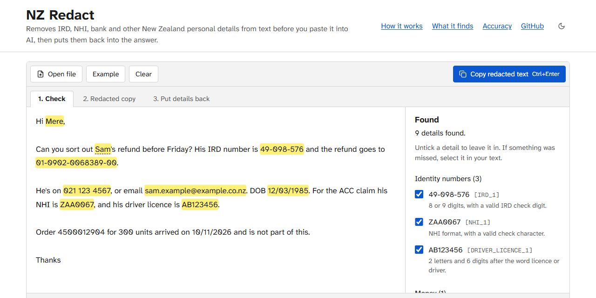

# NZ Redact

Take New Zealand personal details out of text before it goes into an AI tool, then put them back into the answer.



Paste an email, a note or a spreadsheet. NZ Redact swaps each detail for a numbered placeholder such as `[IRD_1]`. Paste the redacted copy into any AI tool. When the answer comes back, paste it into step 3 and the real details return.

**[Open NZ Redact](https://langkurst.github.io/nz-redact/)**. It runs on your device, works offline once loaded, and can be installed from the browser.

## What it finds

| Detail | How it is recognised | Example |
|---|---|---|
| IRD number | 8 or 9 digits with Inland Revenue's check digit | `49-098-576` |
| Bank account | Bank, branch, account and suffix with Inland Revenue's bank checksums | `01-0902-0068389-00` |
| NHI number | Both Health New Zealand formats, with the check character | `ZAA0067`, `ABK09WY` |
| Card number | 13 to 19 digits that pass the Luhn check | `4111 1111 1111 1111` |
| Driver licence | 2 letters and 6 digits after the word licence, or in a licence column | `AB123456` |
| Passport number | Letters and digits after the word passport, or in a passport column | `LA123456` |
| Date of birth | A date after DOB, born or birthday, or in a DOB column | `12/03/1985` |
| Email address | Any email address | `sam@example.co.nz` |
| Phone number | NZ mobiles, landlines, 0800 and +64 numbers | `021 123 4567` |
| Street address | A number, a street name and a street type, with suburb, city and postcode | `56 Hinemoa Street, Birkenhead` |
| Name | After a label such as Name, Patient or Dear, in a name column, or signing off a message. Other likely names are marked possible. | `Patient: Eru Waaka` |

Numbers with a check digit are only flagged when the check digit is right, so order numbers and prices are left alone.

## Accuracy

Measured on two sets of 30 NZ documents. Both were written and marked up by hand by someone who could not see the rules.

**Set 1: the original 30 documents.**

| | Result |
|---|---|
| Numbers, dates, emails, phones and addresses found | 95% (80 of 84) |
| People's names found, with possible names | 65% (26 of 40) |
| People's names found by the sure rules alone, as in version 1.0 | 25% (10 of 40) |
| What it removed that was a real detail | 92% |
| Look-alike numbers left alone | 53 of 54 |

**Set 2: 30 documents about names, written for version 1.1.** It was made after the 1.1 rules were finished, and has no numbers, emails or addresses, only names and look-alike words.

| | Result |
|---|---|
| People's names found | 66% (59 of 90) |
| Names removed that were real names | 91% (6 were not) |
| Look-alike words left alone, such as places, months, and words like Will and May | 70 of 74 |

The results for set 1 were known before the work on version 1.1 started. The rules were not tuned on its documents, but that is why set 2 was written.

A name marked possible in the page is a guess from the word itself, for example a common first name in a sentence. It is ticked, so it is removed, and you can untick it.

What it does not catch: about a third of names. Most names are now found, but the ones missed are mostly names in ordinary sentences that are not common first names. Health details written in words, and numbers split across lines or written in words, are not caught either. Always read the redacted copy before you paste it, and use Remove this too for anything it missed.

Company GST numbers and company bank accounts use the same check digits as personal ones, so they are removed too. That is on purpose.

A third set of 80 documents was used while the rules were built. All three sets are in `test/corpus/`, and `npm run eval` measures them again.

## Use it in your own code

The rules are one file with no dependencies: [`src/nz-redact.js`](src/nz-redact.js). It works in the browser (as `window.NZRedact`) and in Node.js.

```js
const NZRedact = require("./nz-redact.js");

const found = NZRedact.scan(text);                  // [{ type, start, end, text, why }, ...]
const { text: safe, map } = NZRedact.redact(text, found);
// safe: "His IRD number is [IRD_1] and the refund goes to [BANK_ACCOUNT_1]."

const { text: answer } = NZRedact.restore(aiReply, map);
```

| Function | What it does |
|---|---|
| `scan(text, { types })` | Finds details. `types` limits it to some kinds, for example `["ird", "bank"]`. |
| `redact(text, findings)` | Swaps each detail for a numbered placeholder. The same value always gets the same placeholder. Returns the text and the map. |
| `restore(text, map)` | Puts the details back into text that has the placeholders, such as an AI's answer. |
| `irdIsValid`, `bankIsValid`, `nhiIsValid`, `luhnIsValid` | The check-digit rules on their own. |

## How the rules were checked

- **Primary sources.** IRD numbers and bank accounts follow Inland Revenue's 2026 to 2027 validation specification. NHI numbers follow Health New Zealand's standard HISO 10046:2025, including its worked examples. The current bank codes come from the Payments NZ bank branch register (October 2026).
- **An independent library.** 6,000 IRD and bank cases generated by [python-stdnum](https://arthurdejong.org/python-stdnum/) agree with these rules, except where Inland Revenue's current specification differs. Those differences (the higher IRD range, and how algorithms E and G add digits) are pinned by tests.
- **Every rule has a test that fails without it.** Run `npm test`.

## Privacy

The page has a security policy that blocks it from connecting to anything, so text you paste cannot be sent anywhere. The only network requests are the page loading its own files. Nothing is stored: the placeholder list is forgotten when you close the tab. There are no cookies, analytics or tracking. The Ko-fi link in the footer opens Ko-fi's own site; this page sends nothing to it.

## Run it locally

```bash
git clone https://github.com/Langkurst/nz-redact.git
cd nz-redact
npm test
python -m http.server 8000
```

Then open http://localhost:8000. There is no build step.

## Contributing

Found something it misses, or flags by mistake? [Open an issue](https://github.com/Langkurst/nz-redact/issues) with a made-up example. Never paste real personal details into an issue. See [CONTRIBUTING.md](CONTRIBUTING.md).

## Support

Free and open source. If it saved you time, you can support my work on [Ko-fi](https://ko-fi.com/keaclip).

## Licence

MIT. Made by Christopher Nottle in Auckland. Fonts: Atkinson Hyperlegible Next and Geist Mono (SIL OFL 1.1). Icons: Lucide (ISC licence).
